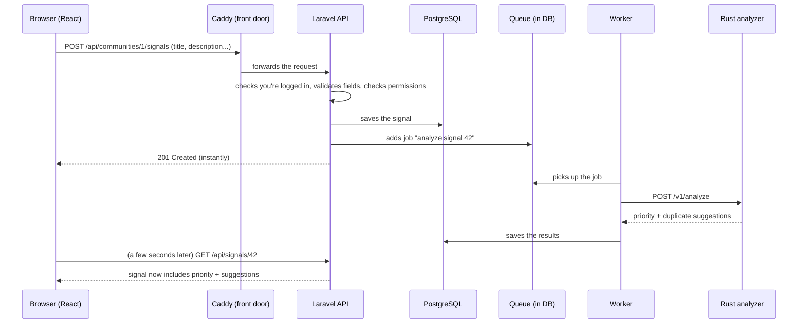

# Ripple: Beginner-Friendly Roadmap (v3)

> **Who this is for:** someone who already knows **React** and **Rust**, and is new to Laravel/PHP, databases on a server, Docker, deployment, CI/CD, and NixOS.
>
> **What changed from v2:** much smaller scope, every unfamiliar word is explained, each phase says *why* a tool exists before showing *how* to use it, and risky or optional things are pushed to the end.
>
> **Cost:** $0. Everything runs on your own computer (and one virtual machine at the end).
>
> **Honest time estimate:** about **17 working days at ~6 h/day (~100 h)**. At 3–4 h/day that is about 5 weeks. This is a learning project, so slower is fine. Items marked **(verify)** are version-specific details I could not confirm; check the official docs.

---

## Table of contents

1. What you are building (plain words)
2. Your map: what you already know → what it maps to
3. Glossary (read once, come back often)
4. The simplified scope
5. Tools to install
6. The phases (this is the actual plan)
7. Optional extras (only after everything works)
8. Command cheat sheet
9. When you are stuck
10. Final checklist
11. Links

---

## 1. What you are building (plain words)

**Ripple** is a small website where people in a group (a lab, a coworking space, a team) report **small recurring problems**: "the printer jams again", "Wi-Fi drops in room 204 every afternoon".

One report is just a single observation. But if several different people say "me too", it is a **pattern** worth fixing. Ripple helps by:

- letting people **confirm** ("I saw it too") and **comment**,
- letting a **moderator** mark the problem as being investigated or resolved,
- using a small **Rust program** to suggest a **priority score** and **possible duplicates** (similar earlier reports).

We call one report a **signal**.

### The pieces and what each one does

| Piece | In plain words | Technology |
|---|---|---|
| **Frontend** | The pages the user sees and clicks | React + TypeScript |
| **Backend / API** | The "brain": checks who you are, stores data, enforces rules | Laravel (PHP) |
| **Analyzer** | A tiny calculator service: "how similar are these two texts? what priority?" | Rust + Actix |
| **Database** | Long-term storage for users, signals, comments | PostgreSQL |
| **Queue + worker** | A to-do list for slow jobs, and a helper that works through it | Laravel queue (stored in the database) |
| **Reverse proxy** | The front door: one address that forwards to the right piece | Caddy |
| **Containers** | Boxes that package each piece so it runs the same everywhere | Docker + Compose |
| **CI** | A robot that runs your tests automatically on every push | GitHub Actions |
| **Server OS** | The operating system on the machine that runs it all | NixOS (in a VM) |
| **Backups** | Copies of your data so you can recover from disaster | `pg_dump` (+ optional Restic) |

### What happens when a user submits a report



**Why the queue?** The user shouldn't wait for slow work, and if the Rust service is down the report must **still be saved**. The queue makes the slow part happen "in the background".

---

## 2. Your map: what you already know → what it maps to

### 2.1 Rust ↔ PHP (you will read and write some PHP)

PHP is the language Laravel uses. Roughly:

| Rust / ecosystem | PHP / Laravel equivalent |
|---|---|
| `cargo` | `composer` (installs packages) |
| `Cargo.toml` | `composer.json` |
| `target/` build folder | `vendor/` (downloaded packages; you never edit it) |
| `let x = 5;` | `$x = 5;` (every variable starts with `$`) |
| `struct Foo { a: i32 }` | `class Foo { public int $a; }` |
| `foo.bar()` | `$foo->bar()` (arrow instead of dot) |
| `Foo::new()` (associated function) | `Foo::create()` (`::` for static methods) |
| `Vec<T>` / `HashMap<K,V>` | arrays: `[1,2,3]` and `['key' => 'value']` |
| `Option<T>` / `None` | a value or `null` |
| `Result<T,E>` and `?` | **exceptions**: `throw`/`try`/`catch` (errors fly up automatically) |
| `use crate::foo::Bar;` | `use App\Models\Bar;` |
| compile-time type checking | types are **checked at runtime** (type hints help, but PHP won't stop you at compile time) |
| `trait` | `trait` (similar idea: reusable method bundles) or `interface` |

**Important mindset change:** PHP will happily run code that has a typo in a rarely used branch. In Rust the compiler protects you; in Laravel **tests** protect you. That's why tests appear early in this plan.

### 2.2 React ↔ Laravel (same ideas, different names)

| In React/TypeScript | In Laravel |
|---|---|
| React Router route | Laravel **route** (`routes/api.php`): "when this URL is requested, call this function" |
| A component's event handler | A **controller** method |
| A zod schema | A **Form Request** (validation rules) |
| The shape of an API response type | An **API Resource** (decides which fields go in the JSON) |
| `if (user.role !== 'mod') return` | A **Policy** (central "is this user allowed to do this?" rules) |
| Redux store / server cache | The **database**, accessed through **Eloquent models** |
| An npm script | An **Artisan** command (`php artisan ...`) |
| Vitest | PHPUnit or **Pest** (Laravel's test tools) |

---

## 3. Glossary

Skim this once now. Every term shows up later with a "why" and an example. Terms are grouped by topic. **"In Ripple:"** tells you where you will meet each one.

### 3.1 Web basics

- **HTTP request / response:** A browser (or program) sends a *request* ("give me this page", "save this data"); a server sends back a *response*. Everything on the web is this ping-pong.
- **Method (GET, POST, PATCH, DELETE):** The "verb" of a request. GET = read, POST = create, PATCH = partially update, DELETE = remove.
- **Status code:** A number in the response saying what happened. `200` OK, `201` created, `204` OK with no body, `401` you're not logged in, `403` you're logged in but not allowed, `404` not found, `419` session/CSRF token expired (a Laravel-specific code), `422` your data is invalid, `429` too many requests, `500` the server crashed.
- **JSON:** Text format for data (`{"title": "Printer jams"}`). Frontend and API talk in JSON.
- **REST API:** A way to design an API so URLs are "things" (`/signals/42`) and methods are verbs (GET/POST/...). *In Ripple:* the whole Laravel backend.
- **Endpoint:** One URL + method, for example `POST /api/auth/login`.
- **Header:** Extra info attached to a request/response (like `Accept: application/json`, which tells Laravel "reply with JSON, not an HTML page").
- **Cookie:** A small piece of data the server asks the browser to remember and send back on every request. It is how "you're still logged in" works.
- **Session:** Server-side memory of "this cookie belongs to user #7". The cookie is just a key; the session is what it unlocks.
- **CSRF (Cross-Site Request Forgery):** An attack where a malicious website tricks your browser into sending a request to another site where you're logged in (your cookie goes along automatically). The defence is a secret **CSRF token** that only your real frontend knows. *In Ripple:* Laravel gives your React app a token cookie; React sends it back in a header on every write request.
- **CORS:** Browser rule that blocks a web page from calling a *different origin* unless that server allows it. We avoid the whole problem by serving frontend and API from **one origin**.
- **Origin:** scheme + host + port, e.g. `http://localhost:5173`. Different port = different origin.
- **Same-origin:** Frontend and API share the exact same origin. Then cookies "just work" and CORS never appears. *In Ripple:* the Vite dev proxy (development) and Caddy (production) make this happen.
- **Authentication vs authorization:** *Authentication* = "who are you?" (login). *Authorization* = "are you allowed to do this?" (permissions).
- **Rate limiting:** Capping how many requests someone can make per minute, to stop abuse (e.g., password guessing).
- **HTTPS / TLS / certificate:** HTTPS encrypts traffic. A *certificate* proves a site is who it says. *In Ripple:* we start with plain HTTP in the lab (simpler) and explain HTTPS as an optional upgrade.
- **DNS / hosts file:** DNS turns names (`ripple.test`) into IP addresses. Your computer's **hosts file** is a tiny local override: "`ripple.test` means this IP". We use it so we need no domain.

### 3.2 Laravel and PHP

- **PHP:** The programming language Laravel is written in.
- **Composer:** PHP's package manager (like cargo/npm).
- **Framework:** A big toolbox plus a recommended structure, so you don't reinvent login, validation, routing, etc. Laravel is the framework.
- **Artisan:** Laravel's command-line tool. `php artisan make:model Signal` creates files for you; `php artisan migrate` updates the database. You'll use it daily.
- **Route:** A rule: "requests to this URL+method are handled by this code". Lives in `routes/api.php`.
- **Controller:** A class with methods that handle routes. Keep them thin: receive request → call logic → return response.
- **Middleware:** Code that runs *before* (or after) a controller, like a security checkpoint. Example: "is the user logged in?" or "has this user made too many requests?".
- **Request object:** What Laravel hands your controller: the incoming data, the current user (`$request->user()`), etc.
- **Form Request:** A class that holds the **validation rules** for one endpoint (e.g., title is required, max 120 chars, impact is 1–5). If invalid, Laravel automatically replies `422` with error messages per field. *In Ripple:* your React forms map those messages onto input fields.
- **API Resource:** A class that converts a model into the exact JSON you want to expose (hide passwords, rename fields, include related data).
- **Eloquent / ORM:** An **ORM** (Object-Relational Mapper) lets you work with database rows as objects: `Signal::find(42)` instead of writing SQL. Eloquent is Laravel's ORM.
- **Model:** A PHP class representing one table (`Signal` ↔ `signals`).
- **Relationship:** "A community has many signals" / "a signal belongs to a community". Defined as methods on models.
- **Migration:** A versioned, replayable **script that changes the database structure** (create a table, add a column). Think "Git history for your schema". Run with `php artisan migrate`.
- **Factory:** Code that generates **fake but realistic** rows for testing and demos.
- **Seeder:** A script that fills the database with starting data (usually using factories).
- **Policy:** A class answering "can user X do action Y on thing Z?" (e.g., "can this user resolve this signal?"). Keeps permission logic in one place instead of scattered `if`s.
- **Laravel Sanctum:** The part of Laravel that makes **cookie-based login** work for a single-page app like yours. It does *not* give you login pages or endpoints; you write simple register/login/logout endpoints yourself.
- **Queue:** A list of jobs waiting to be done in the background.
- **Job:** One unit of background work, as a class (`AnalyzeSignal`).
- **Worker:** A long-running process (`php artisan queue:work`) that keeps taking jobs from the queue and running them. If the worker isn't running, jobs just sit there.
- **Event / Listener:** An event is "something happened" (`SignalCreated`); a listener is code that reacts to it (dispatch an analysis job). A tidy way to avoid putting everything in the controller.
- **Cache:** Temporary storage for results that are expensive to compute, so you don't recompute them every time.
- **Scheduler:** Laravel's built-in "run this every day" feature. (Optional in this plan.)
- **Health endpoint:** A URL like `/up` that returns 200 if the app is alive. Laravel has `/up` built in.
- **Tinker:** `php artisan tinker` gives you an interactive PHP shell inside your app. Great for experimenting (like a REPL).
- **Test (feature test):** Code that makes fake HTTP requests to your API and checks the responses and database. *In Ripple:* your safety net, since PHP won't catch mistakes at compile time.
- **.env file:** A file of settings and secrets for one environment (DB password, app key). **Never commit it to Git.** `.env.example` is the committed template with fake values.

### 3.3 Databases

- **Database:** Organised, durable storage. Survives restarts.
- **SQL:** The language for talking to relational databases.
- **PostgreSQL ("Postgres"):** A popular, robust database server. *In Ripple:* production and Docker database. (During early development we use SQLite, a database that is just one file, to avoid setup.)
- **SQLite:** A database stored in a single file. Zero setup. Great for learning, less suited to servers with several processes writing at once.
- **Table / row / column:** Spreadsheet words: a table is a sheet, a row is one entry, a column is one field.
- **Primary key:** The unique id of a row.
- **Foreign key:** A column pointing to a row in another table (`community_id` on a signal).
- **Index:** A lookup structure that makes searching/sorting by a column fast.
- **Unique constraint:** A database rule that forbids duplicates (e.g., one confirmation per user per signal). Always enforce important rules in the database too, not just in code.
- **Dump / restore:** A *dump* is a file that contains your database's contents (`pg_dump`); *restore* loads it into a database again.

### 3.4 Docker

- **Container:** A lightweight isolated "box" that runs one program with everything it needs. It starts in a second and behaves the same on any machine.
- **Image:** The frozen *recipe result* a container starts from (like a class vs an object). You **build** an image once and **run** many containers from it.
- **Dockerfile:** The text file with instructions to build an image ("start from PHP, copy my code, install packages").
- **Multi-stage build:** A Dockerfile with several stages: the first has heavy build tools (Rust compiler, Node), the last copies *only the result* into a small image. *In Ripple:* the Rust analyzer and the React build both use it.
- **Volume:** Storage that lives **outside** the container so data survives when the container is deleted. *In Ripple:* the database must use one, or you'd lose data on every restart.
- **Network (Docker network):** A private virtual network connecting your containers. Containers reach each other by **service name** (`postgres`, `analyzer`) instead of IP.
- **Port publishing (`ports: "80:80"`):** Opens a container port to the outside world. Only publish what must be public (Caddy). Never publish the database.
- **Docker Compose:** One file (`compose.yaml`) that describes *all* your containers, networks, and volumes, so `docker compose up` starts the entire app.
- **Service:** One entry in a Compose file (e.g., `postgres`, `analyzer`).
- **Health check:** A command Docker runs repeatedly to ask "is this container actually working?".
- **Restart policy (`restart: unless-stopped`):** Tells Docker to restart a container if it crashes or after the machine reboots.
- **`.dockerignore`:** List of files Docker should not copy into the image (like `node_modules`, `.env`).
- **Non-root user:** Running a program inside the container as an ordinary user, not all-powerful `root`. Safer if the program is compromised.

### 3.5 Servers and networking

- **Reverse proxy:** A server that receives all requests and **forwards** them to the right internal service. Visitors only ever talk to the proxy. *In Ripple:* **Caddy**.
- **Caddy:** A web server / reverse proxy with a very short config file and automatic HTTPS (when you have a real domain). Here it also serves the built React files.
- **PHP-FPM:** The process manager that actually runs PHP code for web requests. A web server (nginx) hands it requests. (We use a ready-made image that bundles both, so you can ignore this detail at first.)
- **Nginx:** Another web server. Appears inside the PHP image we use.
- **VM (virtual machine):** A pretend computer running inside your real one. Safe to experiment with and break. *In Ripple:* where NixOS runs.
- **SSH:** A secure way to log into another computer's terminal over the network. **SSH key** = a pair of files (private + public) used instead of a password. The private key never leaves your computer.
- **Firewall:** Rules that decide which network ports are reachable from outside. We allow 22 (SSH), 80 (HTTP), and later 443 (HTTPS).
- **Port:** A numbered "door" on a machine (80 = web, 22 = SSH, 5432 = Postgres).
- **systemd:** The program on modern Linux that starts, stops and supervises background services and scheduled tasks ("timers").

### 3.6 CI/CD

- **Git / repository / commit / branch:** Version control. A *repository* holds the project and history; a *commit* is a saved snapshot; a *branch* is a parallel line of work.
- **CI (Continuous Integration):** Automatically running checks (tests, lint, build) on every push or pull request, so you notice breakage immediately.
- **CD (Continuous Delivery/Deployment):** Automatically (or with one click) putting a successful build onto a server.
- **GitHub Actions:** GitHub's built-in CI system. You describe it in a YAML file in `.github/workflows/`.
- **Workflow / job / step:** A workflow is one automation file; it has jobs (run on a fresh machine); each job has steps (commands).
- **Runner:** The machine that executes a job. *GitHub-hosted* runners are cloud machines; *self-hosted* runners are machines you own. GitHub-hosted runners **cannot reach your home VM**, which is why deployment is manual at first.
- **Lint / formatter:** Tools that check style and common mistakes (clippy for Rust, Pint for PHP, ESLint for TS).
- **Secret (GitHub):** An encrypted value stored in GitHub settings that workflows can use (never print them).
- **Registry (e.g., GHCR):** A place to store container images so servers can download them. Optional here.
- **Deploy:** Put a new version onto the server and start it.
- **Rollback:** Going back to the previous version.
- **Environment variable:** A setting passed to a program from outside (`DB_PASSWORD=...`) instead of written in code.
- **Secrets hygiene:** Never put passwords/keys in Git, in images, or in logs.

### 3.7 NixOS

- **Linux distribution:** A flavour of Linux (Ubuntu, Debian, NixOS...).
- **NixOS:** A Linux distro where the **whole system is described in config files**. Instead of running install commands by hand, you edit a file and ask the system to rebuild itself to match.
- **Nix:** The package manager/language underneath NixOS. Nix files use their own small language (looks a bit like JSON with functions).
- **`configuration.nix`:** The main file describing your machine: users, SSH, firewall, installed programs, Docker.
- **Module / option:** Settings you switch on in that file, e.g. `virtualisation.docker.enable = true;`.
- **Flake:** A newer standard way to package a Nix config with **pinned inputs** (exact versions), described in `flake.nix` and locked in `flake.lock`. Like `Cargo.lock` for your OS.
- **Generation:** Every successful rebuild creates a new numbered "version" of the system. You can boot or switch back to older ones. This is NixOS's superpower: **easy rollback of the operating system**.
- **`nixos-rebuild switch`:** Apply the config now (and make it the boot default). **`test`** applies it now but not for next boot. **`--rollback`** returns to the previous generation.
- **Nix store:** Where Nix keeps all packages, in a **readable-by-everyone** location. So never put secrets inside Nix files.

### 3.8 Backups and recovery

- **Backup:** An extra copy of data, kept somewhere else.
- **Restore:** Using a backup to rebuild data.
- **Restore test:** Actually restoring into a scratch environment to prove the backup works. *A backup you've never restored is a hope, not a backup.*
- **Snapshot:** A point-in-time backup.
- **RPO (Recovery Point Objective):** How much recent data you can afford to lose. Daily backup ≈ up to 24 h.
- **RTO (Recovery Time Objective):** How long you can afford to be down while recovering.
- **Restic (optional):** A backup tool that encrypts and deduplicates snapshots.
- **Off-host backup:** Stored on a different machine/disk. A backup on the same disk as the data won't save you from that disk dying.

---

## 4. The simplified scope

### 4.1 What was cut (and why)

| Removed | Why | When you could add it |
|---|---|---|
| Redis | Laravel can keep its queue/cache/sessions **in the database**. One less service to learn. | Optional extras |
| Notifications, follows, daily digest, scheduler | Nice but not needed to learn the core ideas | Optional extras |
| Image uploads | Adds private file storage and extra security decisions | Optional extras |
| Gatus, Beszel, Umami | Three monitoring/analytics tools = too much at once | Optional extras |
| Container registry + automatic deploy | Needs a self-hosted runner or tunnel; builds on the VM are fine for a lab | Optional extras |
| Separate Nginx container, HTTPS in the lab | Use a combined PHP image; use HTTP first | Optional extras |
| Roles beyond member/moderator, "Corroborated"/"Archived" states | Fewer rules to get right | Optional extras |

### 4.2 Features that remain (the MVP)

1. Register, log in, log out.
2. Create a community (get an **invite code**); join one with a code.
3. Create a signal: title, description, category, zone, impact (1–5).
4. List signals with filters (status, category, zone, search) and sorting (priority / newest).
5. Confirm a signal ("me too"), once per user. Comment on a signal.
6. Moderators move a signal: **Open → Investigating → Resolved** (and can reopen).
7. Background job: Rust returns a **priority** and **similar signals**.
8. Show it all in React.

### 4.3 Rules (so you don't have to invent them)

**Roles:** `member` (default) or `moderator`. The community creator is a moderator. Role is stored on the membership; the frontend never sends "I am a moderator".

**Status changes (enforced by Laravel, not trusted from React):**

| From | To | Allowed for |
|---|---|---|
| Open | Investigating | moderator |
| Investigating | Resolved | moderator (note required) |
| Resolved | Open | moderator (reopen) |

Anything else → `422`. "Corroborated" is just a **label computed in React** when there are 2+ confirmations from people other than the author.

**Priority formula (lives in Rust):**

```
recency   = exp(-age_days / 14)
priority  = round(100 * (0.45 * impact/5  +  0.35 * min(confirmations,5)/5  +  0.20 * recency))
```

This is just a starting guess. The weights are not scientific. Keep them in one place so they're easy to change.

**Similarity (Rust):** lowercase, remove punctuation and common words, split into words, compute **Jaccard similarity** (shared words ÷ total distinct words). Add +0.15 if same zone and +0.10 if same category. Return up to 5 candidates scoring ≥ 0.35.

### 4.4 Data (tables)

| Table | Important columns |
|---|---|
| `users` | name, email (unique), password (stored hashed by Laravel) |
| `communities` | name, invite_code (unique) |
| `community_user` | community_id, user_id, role; unique(community_id, user_id) |
| `signals` | community_id, author_id, title, description, category, zone, impact, status, priority, analysis_status (`pending`/`done`/`failed`), resolution_note |
| `confirmations` | signal_id, user_id; unique(signal_id, user_id) |
| `comments` | signal_id, user_id, body |
| `signal_matches` | signal_id, matched_signal_id, score, reasons (json) |
| (Laravel's own) | `jobs`, `failed_jobs`, `sessions`, `cache`, `personal_access_tokens` (created by installers) |

### 4.5 API list (write this into `docs/api-contract.md` on day 1)

| Area | Endpoints |
|---|---|
| Auth | `POST /api/auth/register`, `POST /api/auth/login`, `POST /api/auth/logout`, `GET /api/me` |
| Communities | `GET /api/communities`, `POST /api/communities`, `POST /api/communities/join` |
| Signals | `GET /api/communities/{id}/signals`, `POST /api/communities/{id}/signals`, `GET /api/signals/{id}` |
| Actions | `POST /api/signals/{id}/confirm`, `DELETE /api/signals/{id}/confirm`, `POST /api/signals/{id}/transition` |
| Comments | `GET /api/signals/{id}/comments`, `POST /api/signals/{id}/comments` |
| Matches | `GET /api/signals/{id}/matches` |
| Health | `GET /up` (built in), later `GET /api/ready` |

Error format: validation errors come as `422` with `{ "message": "...", "errors": { "title": ["The title field is required."] } }`.

### 4.5b Rust request/response

`POST /v1/analyze`

```json
{
  "signal": { "id": 12, "title": "...", "description": "...", "category": "network",
              "zone": "lab-2", "impact": 4, "confirmations": 2,
              "created_at": "2026-11-01T09:00:00Z" },
  "candidates": [ { "id": 7, "title": "...", "description": "...",
                    "category": "network", "zone": "lab-2" } ]
}
```

Response:

```json
{ "priority": 72,
  "matches": [ { "signal_id": 7, "score": 0.61, "reasons": ["shared_keywords", "same_zone"] } ] }
```

Also `GET /health` → 200. Limit candidates to 200 and request size to ~256 KB.

---

## 5. Tools to install (Phase 0)

| Tool | Why | Check it works |
|---|---|---|
| **Git** | Version control | `git --version` |
| **PHP 8.3 or newer** | Laravel 13 requires PHP 8.3+ (confirmed) | `php -v` |
| **Composer** | PHP packages | `composer -V` |
| **Laravel installer** *(optional)* | `laravel new`; or use `composer create-project laravel/laravel` | `laravel --version` |
| **Node.js (LTS)** | Frontend tooling | `node -v` |
| **Rust (rustup)** | You already know it | `cargo -V` |
| **Docker + Compose** | Containers | `docker compose version` |
| **A VM program** (VirtualBox / virt-manager / GNOME Boxes) | For NixOS later | opens |
| **Editor** | VS Code with PHP + Rust + Tailwind extensions, or PhpStorm (paid) | |
| **A DB viewer** *(optional)* | DBeaver (free) to look at tables | |

Laravel's docs have an "Installation" page with a quick one-command setup for PHP + Composer per operating system **(verify the current command there)**. Laravel 13's default new project uses **SQLite and database-backed queue/session/cache**, which is exactly what we want at the start (**verify** after creating the project by reading `.env`).

---

## 6. The phases

Each phase has: **Concepts** (the ideas), **Steps** (numbered), **Done when** (a checklist). Day estimates assume ~6 h days.

---

### Phase 0: Setup and orientation (1 day)

**Concepts:** Install the tools. Understand §1 and §2 of this file. Don't memorise the glossary.

**Steps**

1. Install everything in §5. Fix any missing version before moving on.
2. Create a GitHub account/repository `ripple` (private is a good default) and clone it.
3. Make the folder layout:
   ```text
   ripple/
   ├── backend/    (Laravel)
   ├── analyzer/   (Rust)
   ├── frontend/   (React)
   ├── infra/      (Docker/Caddy/scripts)
   ├── docs/       (api-contract.md, runbook.md)
   └── README.md
   ```
4. Add a `.gitignore` that ignores `.env`, `vendor/`, `node_modules/`, `target/`, `*.log`.
5. Write `docs/api-contract.md` by copying §4.5. This is your plan for both sides.
6. **PHP warm-up (1–2 h):** open a scratch file and write: a class with a method, an array loop, a function with type hints, `try/catch`. Run with `php file.php`. You only need to be able to *read* PHP comfortably.

**Done when**

- [ ] `php -v`, `composer -V`, `node -v`, `cargo -V`, `docker compose version` all work
- [ ] The repo exists with the folder structure and the API contract

---

### Phase 1: Laravel API (Days 1–4)

#### Day 1: Project, database, models

**Concepts**

- Laravel's folders: `routes/` (URLs), `app/Http/Controllers/` (handlers), `app/Models/` (tables as classes), `database/migrations/` (schema history), `database/factories/` and `seeders/` (fake data), `tests/` (tests), `.env` (settings).
- **Migration** = the schema as versioned code. You never click around in a database to change structure; you write a migration.
- **Eloquent relationships** let you write `$community->signals` instead of SQL joins.

**Steps**

1. In `backend/`, create the project (`composer create-project laravel/laravel .` or `laravel new`). Run `php artisan serve` and open the URL. See the welcome page.
2. Run `php artisan install:api`. This sets up Sanctum and creates `routes/api.php` **(verify in the Laravel 13 docs)**. Open `routes/api.php` and read it.
3. Read `.env`: find the database, queue, session, and cache settings. Understand each.
4. Generate models with migrations: `php artisan make:model Community -mf` (`-m` migration, `-f` factory). Repeat for `Signal`, `Confirmation`, `Comment`, `SignalMatch`. For the membership table create a migration with `php artisan make:migration create_community_user_table`.
5. Fill in the migrations from §4.4. Example:
   ```php
   Schema::create('signals', function (Blueprint $table) {
       $table->id();
       $table->foreignId('community_id')->constrained()->cascadeOnDelete();
       $table->foreignId('author_id')->constrained('users');
       $table->string('title');
       $table->text('description');
       $table->string('category');
       $table->string('zone');
       $table->unsignedTinyInteger('impact');       // 1-5
       $table->string('status')->default('open');
       $table->unsignedTinyInteger('priority')->nullable();
       $table->string('analysis_status')->default('pending');
       $table->text('resolution_note')->nullable();
       $table->timestamps();                         // created_at, updated_at
       $table->index(['community_id', 'status']);
   });
   ```
   For `confirmations` add `$table->unique(['signal_id', 'user_id']);`.
6. Run `php artisan migrate`. Look at the tables in a DB viewer.
7. Write relationships in the models: `Community hasMany Signal`, `Signal belongsTo Community`, `Signal hasMany Comment`, `Community belongsToMany User` (through `community_user`, with the `role` column via `withPivot('role')`).
8. Fill factories; write a `DatabaseSeeder` that creates ~3 communities, ~10 users, ~40 signals, confirmations, comments.
9. Run `php artisan migrate:fresh --seed` and explore data with `php artisan tinker` (e.g., `App\Models\Signal::with('community')->first()`).

**Done when**

- [ ] `migrate:fresh --seed` runs without errors and gives realistic data
- [ ] In tinker you can follow relationships both ways
- [ ] You can explain in one sentence what a migration, a model, and a factory are

#### Day 2: Authentication (the trickiest idea of the week)

**Concepts**

- **How cookie login works:** you POST email+password → Laravel checks them → Laravel starts a *session* and sends a *session cookie* → on every later request the browser automatically sends that cookie → Laravel knows who you are.
- **Why CSRF:** because the browser attaches the cookie automatically, another site could trigger requests as you. So write requests must also carry a secret token. Sequence for the frontend: first `GET /sanctum/csrf-cookie` (Laravel sets an `XSRF-TOKEN` cookie), then send that value in an `X-XSRF-TOKEN` header on `POST/PATCH/DELETE`.
- **Sanctum "stateful" setting:** Laravel must know which frontend hosts count as your own SPA (`SANCTUM_STATEFUL_DOMAINS` in `.env`). The host includes the port if it isn't 80/443 (e.g., `localhost:5173`).
- **Why one origin:** if the React dev server proxies `/api` to Laravel, the browser thinks both are the same site, and cookies/CORS behave. That is the plan.

**Steps**

1. Create `AuthController` with `register`, `login`, `logout`, `me`.
   - `register`: validate (name, email unique, password min 8, confirmed), `User::create` with hashed password, log the user in.
   - `login`: validate, `Auth::attempt([...])`, then `$request->session()->regenerate()` (this blocks "session fixation" attacks). Return `422` with a message on bad credentials.
   - `logout`: log out, invalidate the session, regenerate the CSRF token.
   - `me`: return the current user.
2. Routes: put `register` and `login` outside the auth group; `logout` and `me` inside `middleware('auth:sanctum')`.
3. Add rate limiting to login: `->middleware('throttle:6,1')` (6 tries per minute).
4. In `.env` set `SANCTUM_STATEFUL_DOMAINS=localhost:5173` (and the same host you'll use) and keep session cookie settings default **(verify against the Sanctum docs)**.
5. Write feature tests: register works; duplicate email gives 422; login works; wrong password fails; `me` without login gives 401.
6. Test by hand with a tool like Bruno/Postman/`curl`, remembering the CSRF dance. (If that's annoying, it's the test suite's job, and the browser will do it for you later.)

**Done when**

- [ ] All auth tests pass (`php artisan test`)
- [ ] You can describe, in your own words, what the CSRF cookie is for

#### Day 3: Communities, signals, confirmations, comments

**Concepts**

- **Route model binding:** if a route is `/signals/{signal}` and your method takes `Signal $signal`, Laravel automatically loads it (or returns 404).
- **Validation in Form Requests**, **JSON out through API Resources**.
- **Eager loading** (`with('author')`) avoids running one database query per row (the "N+1 problem").
- **Pagination:** return pages, not thousands of rows.
- **Transactions:** group several database writes so they all succeed or none do.

**Steps**

1. `CommunityController`: list mine, create (generate random invite code, attach creator as `moderator`), join by invite code (attach as `member`; ignore if already a member).
2. `SignalController`:
   - `index`: filters `status`, `category`, `zone`, `q` (search in title/description), `sort=priority|recent`, paginate 15. Use query scopes or conditional `when(...)`.
   - `store`: use a `StoreSignalRequest`. Example of how thin the controller can be:
     ```php
     public function store(StoreSignalRequest $request, Community $community)
     {
         $this->authorize('createSignal', $community);  // policy, see Day 4
         $signal = $community->signals()->create([
             ...$request->validated(),
             'author_id' => $request->user()->id,
         ]);
         return new SignalResource($signal);  // 201 handled for you when newly created
     }
     ```
   - `show`: return signal with author, confirmation count, whether *you* confirmed.
3. Confirmations: `POST` creates (ignore if exists, rely on the unique index too), `DELETE` removes. Authors can't confirm their own signal (decide and write it in the contract).
4. Comments: list + create with a `StoreCommentRequest`.
5. `SignalResource`, `CommentResource`, `UserResource` (only id and name, never email or password).
6. Add the routes grouped under `auth:sanctum`.
7. Feature tests: creating a signal (valid and invalid), listing with filters, duplicate confirmation, comments.

**Done when**

- [ ] The entire API from §4.5 (except transitions/matches) works in tests
- [ ] A user cannot see signals from a community they haven't joined (write the test, even if you add the check in Day 4)

#### Day 4: Permissions, status changes, polish

**Concepts**

- **Policy:** one class per model with methods like `view`, `create`, `transition`. Controllers ask `authorize(...)`. A failed check automatically returns `403`.
- **Never trust the client:** the frontend might *hide* a button, but the server must still refuse.
- A **state machine** (the table in §4.3) is just: "from this status, only these next statuses".

**Steps**

1. Create `CommunityPolicy` / `SignalPolicy`. Rules:
   - view/list/create/comment/confirm: must be a member of the community.
   - transition: must be a moderator of that community.
2. `POST /api/signals/{id}/transition` with `{to, note}`. Validate `to` with the allowed table; require `note` when resolving; set `resolved_at`/`resolution_note`.
3. Add `throttle` limits on creating signals and confirming (e.g., 30/min).
4. Add `GET /api/ready` which checks the database connection and returns 200/503.
5. Tests: member cannot transition (403); moderator can; invalid transition (422); non-member gets 403/404 on community data.
6. Run `php artisan test` and fix everything. Commit.

**Done when**

- [ ] The API works **without any frontend**, and permissions are tested
- [ ] `php artisan test` is green

---

### Phase 2: React frontend (Days 5–8)

You know React; the new part is **talking to a cookie-authenticated Laravel API**.

**Concepts**

- **Same-origin through Vite's proxy:** in `vite.config.ts` forward `/api` and `/sanctum` to `http://localhost:8000`, so the browser only ever talks to `localhost:5173`.
  ```ts
  export default defineConfig({
    plugins: [react()],
    server: { proxy: { '/api': 'http://localhost:8000', '/sanctum': 'http://localhost:8000' } },
  })
  ```
- **TanStack Query** handles loading/error/caching of server data; you invalidate after mutations.
- **Send `Accept: application/json`** or Laravel may reply with an HTML error page.
- **Server state vs UI state:** data from the API goes in the query cache, not in `useState`.

**Stack:** Vite + React + TypeScript (strict), React Router, TanStack Query, react-hook-form + zod, Tailwind CSS (+ shadcn/ui-style components if you like; **verify install steps**), Vitest + Testing Library.

#### Day 5: Scaffold, API client, auth

**Steps**

1. `npm create vite@latest frontend -- --template react-ts` (in the repo root), install the libraries, add the proxy.
2. Folder structure:
   ```text
   frontend/src/
   ├── api/         # client.ts, auth.ts, signals.ts, types.ts
   ├── features/    # auth/, communities/, signals/
   ├── components/  # Button, Spinner, EmptyState, ErrorMessage, Toast
   ├── routes/      # router.tsx, ProtectedRoute.tsx
   └── lib/         # zod schemas, helpers
   ```
3. Build one `api()` wrapper that does all the Laravel-specific work (sketch):
   ```ts
   const getCookie = (name: string) =>
     document.cookie.split('; ').find(r => r.startsWith(name + '='))?.split('=')[1];

   let csrfReady = false;

   export async function api<T>(path: string, init: RequestInit = {}): Promise<T> {
     const method = (init.method ?? 'GET').toUpperCase();
     if (method !== 'GET' && !csrfReady) {
       await fetch('/sanctum/csrf-cookie', { credentials: 'include' });
       csrfReady = true;
     }
     const xsrf = getCookie('XSRF-TOKEN');
     const res = await fetch(path, {
       ...init,
       credentials: 'include',
       headers: {
         Accept: 'application/json',
         'Content-Type': 'application/json',
         ...(xsrf ? { 'X-XSRF-TOKEN': decodeURIComponent(xsrf) } : {}),
         ...init.headers,
       },
     });
     if (!res.ok) throw await ApiError.from(res); // carries status + Laravel's `errors`
     return res.status === 204 ? (undefined as T) : res.json();
   }
   ```
4. Error mapping in one place:

   | Status | Meaning | React does |
   |---|---|---|
   | 401 | not logged in | clear user, go to login, remember where you were |
   | 403 | not allowed | show a "no permission" message |
   | 419 | CSRF/session expired | fetch the CSRF cookie again, retry once |
   | 422 | validation failed | put `errors.field[0]` under each input |
   | 429 | too many requests | toast "try again in a moment" |
   | 5xx | server problem | generic error with retry |

5. `useMe()` (calls `GET /api/me`; 401 means logged out). `ProtectedRoute` shows a spinner while loading, redirects to `/login` if logged out.
6. Login and Register pages with react-hook-form + zod, showing server errors.
7. Test: login form validation (Vitest + Testing Library).

**Done when**

- [ ] You can register, refresh the page and **stay logged in**, and log out
- [ ] A wrong password shows the server's error message on the form

#### Day 6: Communities and signal list

**Steps**

1. Communities page: list, create form, "join with invite code" form.
2. Signal list page for a community: filters (status, category, zone, search box), sort, pagination, a badge for status and one for priority, confirmation count, and a computed "Corroborated" label when confirmations ≥ 2.
3. Put filters in the **URL query string** (`?status=open&zone=lab-2`) so the list is shareable and survives refresh.
4. Shared components: loading, empty ("No signals yet. Create the first one!"), error with a retry button. Use them on **every** list/detail page.

**Done when**

- [ ] You can join the seeded community and filter/sort the list against the real API

#### Day 7: Create and detail pages

**Steps**

1. New-signal form (title, description, category select, zone, impact 1–5 selector). Validation mirrors the server's rules; server errors still shown per field.
2. Signal detail page: info, confirm/unconfirm button (optimistic update is nice but optional), comments list + add comment form.
3. After creating a signal: invalidate the list query and navigate to the detail page.
4. Analysis status area (will be wired in Phase 3): show "Analysing…", "Analysis unavailable", or the priority + similar signals.

**Done when**

- [ ] Main journey works: create → view → confirm → comment, all in the browser

#### Day 8: Moderation, polish, test

**Steps**

1. Moderator controls on the detail page: a button for each allowed next status; resolving opens a dialog requiring a note. (Show only to moderators, but remember the server enforces it.)
2. Use `403`/`422` messages from the server on failed transitions.
3. Accessibility pass: labelled inputs, visible focus, keyboard-friendly dialogs, status shown with text (not colour alone).
4. Write a few Vitest tests (form validation, a list component with empty/loading/error states).
5. Optional: one Playwright end-to-end test (register → join → create signal). You can postpone it.

**Done when**

- [ ] A teammate could use the app without you explaining it
- [ ] `npm run build` and `npx tsc --noEmit` pass; tests pass

---

### Phase 3: Rust analyzer and queues (Days 9–10)

#### Day 9: The Rust service (your comfort zone)

**Concepts:** This is a normal Actix Web app: Serde for JSON, a pure function for scoring, JSON error responses. The new thing is only *why it's a separate service*: Laravel owns data and rules; Rust is a stateless calculator that never touches the database.

**Steps**

1. `cargo new analyzer`; add `actix-web`, `serde`, `serde_json`, `chrono` (or `time`).
2. `GET /health` → 200 `{"status":"ok"}`.
3. `POST /v1/analyze` with the types from §4.5b. Reject bodies over the size limit and >200 candidates with a `400`/`413` JSON error.
4. Implement tokenizer + stop-words + Jaccard + same-zone/category bonus + priority formula from §4.3. Keep weights in a `const` block.
5. Unit tests: identical texts score high; unrelated texts score low; priority rises with impact and confirmations, falls with age.
6. `cargo fmt`, `cargo clippy -- -D warnings`, `cargo test`.
7. Test with `curl` using a JSON file.

**Done when**

- [ ] `curl` returns a believable priority and matches; tests and clippy pass

#### Day 10: Queue, job, and the Laravel → Rust call

**Concepts**

- **How a queued job works:** the controller puts a record in the `jobs` table; a separate **worker** process reads it and runs the job's `handle()`. If `handle()` throws, Laravel retries (`tries`) and eventually records it in `failed_jobs`.
- **Idempotent job:** safe to run twice without harm (it overwrites results instead of appending).
- **Timeout:** never wait forever on another service.

**Steps**

1. `QUEUE_CONNECTION=database` in `.env` (check what the installer already set). Make sure the `jobs` table migration has run.
2. Create the job: `php artisan make:job AnalyzeSignal`. Sketch:
   ```php
   class AnalyzeSignal implements ShouldQueue
   {
       use Queueable;
       public int $tries = 3;
       public array $backoff = [5, 20];

       public function __construct(public int $signalId) {}

       public function handle(): void
       {
           $signal = Signal::findOrFail($this->signalId);
           $candidates = Signal::where('community_id', $signal->community_id)
               ->where('status', '!=', 'resolved')->where('id', '!=', $signal->id)
               ->latest()->limit(200)->get(['id','title','description','category','zone']);

           $response = Http::timeout(5)->post(config('services.analyzer.url').'/v1/analyze', [
               'signal' => [/* fields from §4.5b */],
               'candidates' => $candidates,
           ])->throw();                       // turn HTTP errors into exceptions

           // save priority + matches, set analysis_status = 'done'
       }

       public function failed(\Throwable $e): void
       {
           Signal::whereKey($this->signalId)->update(['analysis_status' => 'failed']);
       }
   }
   ```
   Add `ANALYZER_URL=http://localhost:8080` to `.env` and a `services.analyzer.url` entry in `config/services.php`.
3. Dispatch it after saving a signal: `AnalyzeSignal::dispatch($signal->id)->afterCommit();`. Dispatch again after a new confirmation (priority depends on it).
4. Run `php artisan queue:work` in a second terminal while you create signals.
5. `GET /api/signals/{id}/matches` returns stored matches.
6. Tests: `Queue::fake()` to check dispatch; `Http::fake()` to test both the success path and the **Rust-is-down path** (signal still saved, status `failed`).
7. Frontend: poll `GET /api/signals/{id}` every ~3 s while `analysis_status === 'pending'` (stop after ~30 s). Show priority and similar signals.

**Done when**

- [ ] With the analyzer **stopped**, creating a signal still works and ends as "analysis unavailable"
- [ ] With it running, priority and matches appear in the UI within seconds

---

### Phase 4: Docker and Compose (Days 11–12)

**Concepts**

- Until now you ran things "natively". Now we package each piece as an **image**, then **Compose** starts them together on a private network.
- Where each piece lives:
  - `postgres`: a ready-made image; **data in a named volume**.
  - `app`: your Laravel code in a PHP image (serves HTTP).
  - `worker`: the **same image** as `app`, but runs `php artisan queue:work` instead of the web server.
  - `analyzer`: your Rust binary in a small image.
  - `caddy`: serves the built React files and forwards `/api` etc. to `app`. **The only service with a published port.**
- **Switching SQLite → PostgreSQL:** change `.env` DB settings, run migrations again, **rerun your tests**. This catches differences early.

#### Day 11: Build images

**Steps**

1. **Rust Dockerfile (multi-stage):** stage 1 `FROM rust:... AS build` runs `cargo build --release`; stage 2 starts from a slim base, copies the binary, runs as a non-root user. Image goes from ~2 GB to a few dozen MB. Add `.dockerignore` (`target/`).
2. **Laravel image:** pick a production PHP image with a web server built in (for example the `serversideup/php` FPM+Nginx images; **verify** the current image names/tags and which port they listen on, often 8080). Steps: copy code, `composer install --no-dev --optimize-autoloader`, make `storage/` and `bootstrap/cache/` writable, run as non-root. Add `.dockerignore` (`vendor/`, `.env`, `node_modules/`).
3. **Caddy + frontend image (multi-stage):** stage 1 `FROM node:... ` runs `npm ci && npm run build`; stage 2 `FROM caddy:...` copies `dist/` to `/srv/frontend` and your `Caddyfile`.
4. Write the Caddyfile (plain HTTP for the lab):
   ```caddy
   :80 {
       encode zstd gzip

       @laravel path /api/* /sanctum/* /up
       handle @laravel {
           reverse_proxy app:8080     # port depends on your PHP image
       }

       handle {
           root * /srv/frontend
           try_files {path} /index.html   # lets React Router handle deep links
           file_server
       }
   }
   ```
5. Build each image locally and run it alone to check it starts (`docker run`).

**Done when**

- [ ] Three images build; the Rust one is small; none runs as root; no secrets are inside any image

#### Day 12: Compose file and local run

**Steps**

1. Write `infra/compose.yaml`:
   ```yaml
   services:
     postgres:
       image: postgres:17            # pin a major version
       environment:
         POSTGRES_DB: ripple
         POSTGRES_USER: ripple
         POSTGRES_PASSWORD: ${DB_PASSWORD}
       volumes: [pgdata:/var/lib/postgresql/data]
       healthcheck:
         test: ["CMD-SHELL", "pg_isready -U ripple -d ripple"]
         interval: 5s
         retries: 10
       restart: unless-stopped        # no "ports:" on purpose: not reachable from outside

     app:
       build: ../backend
       env_file: ./.env.production    # real file stays out of Git
       depends_on: { postgres: { condition: service_healthy } }
       restart: unless-stopped

     worker:
       build: ../backend              # same image
       command: php artisan queue:work --tries=3
       env_file: ./.env.production
       depends_on: { postgres: { condition: service_healthy } }
       restart: unless-stopped

     analyzer:
       build: ../analyzer
       restart: unless-stopped        # no "ports:" either

     caddy:
       build: { context: .., dockerfile: infra/caddy.Dockerfile }
       ports: ["80:80"]               # the ONLY published port
       depends_on: [app]
       restart: unless-stopped

   volumes:
     pgdata:
   ```
2. Production `.env` values to set: `APP_ENV=production`, `APP_DEBUG=false`, a real `APP_KEY` (`php artisan key:generate --show`), `DB_CONNECTION=pgsql`, `DB_HOST=postgres`, `ANALYZER_URL=http://analyzer:8080` (**the service name is the hostname inside Docker's network**), `QUEUE_CONNECTION=database`, `SESSION_DRIVER=database`, and `SANCTUM_STATEFUL_DOMAINS` matching the host you type in the browser.
3. First start: `docker compose up -d --build`, then run migrations once: `docker compose exec app php artisan migrate --force` (`--force` is required in production mode).
4. Open `http://localhost` and test the whole journey, including the analysis.
5. Persistence test: `docker compose down` (without `-v`) then `up`; data must still be there. (Warning: `down -v` deletes volumes, i.e. your data.)
6. Check `docker compose ps`, `docker compose logs app worker analyzer`.
7. Add `/api/ready` to your health checks. Confirm `psql`/the DB is **not** reachable from your host.

**Done when**

- [ ] `docker compose up` gives you the full working app on one address
- [ ] Data survives restart; DB and analyzer are not exposed

---

### Phase 5: Continuous integration (Day 13)

**Concepts:** A workflow file tells GitHub: "when someone pushes or opens a pull request, start a fresh machine and run these commands". If any command fails, the check fails (a red ✗). It's your tests running without you remembering to run them.

**Steps**

1. Create `.github/workflows/ci.yml` with **three separate jobs** (they run in parallel): `backend`, `analyzer`, `frontend`.
2. Skeleton (check the latest major versions of each action):
   ```yaml
   name: CI
   on:
     push: { branches: [main] }
     pull_request:

   jobs:
     analyzer:
       runs-on: ubuntu-latest
       defaults: { run: { working-directory: analyzer } }
       steps:
         - uses: actions/checkout@v4
         - uses: dtolnay/rust-toolchain@stable
           with: { components: "clippy, rustfmt" }
         - uses: Swatinem/rust-cache@v2
         - run: cargo fmt --check
         - run: cargo clippy --all-targets -- -D warnings
         - run: cargo test

     frontend:
       runs-on: ubuntu-latest
       defaults: { run: { working-directory: frontend } }
       steps:
         - uses: actions/checkout@v4
         - uses: actions/setup-node@v4
           with: { node-version: 22, cache: npm, cache-dependency-path: frontend/package-lock.json }
         - run: npm ci
         - run: npx tsc --noEmit
         - run: npm test --if-present
         - run: npm run build

     backend:
       runs-on: ubuntu-latest
       defaults: { run: { working-directory: backend } }
       steps:
         - uses: actions/checkout@v4
         - uses: shivammathur/setup-php@v2
           with: { php-version: "8.3" }
         - run: cp .env.example .env
         - run: composer install --no-interaction --prefer-dist
         - run: php artisan key:generate
         - run: php artisan test
   ```
   (Backend tests with SQLite in memory are fine for CI at first. Add a Postgres service later if you want parity with production.)
3. Add Laravel's formatter (`vendor/bin/pint --test`) and `composer audit` steps in the backend job.
4. Add **Gitleaks** (scans for accidentally committed secrets), and read its output once. Optionally add Trivy later (see §7): its first run is noisy.
5. Break a test on purpose in a branch, push, and watch CI fail. Fix it, push, watch it go green.
6. In GitHub repo settings, require CI to pass before merging to `main` (branch protection).

**Done when**

- [ ] A failing test turns the check red; a fixed one turns it green
- [ ] No secret is in Git (`.env` ignored; check `git log` once)

---

### Phase 6: Backups and the restore test (Day 14)

**Concepts**

- A **logical dump** (`pg_dump`) exports your database as a file you can reload. Use the **custom format** (`-Fc`), which is compressed and restored with `pg_restore`.
- **Never** copy Postgres's live data folder as a backup.
- Backups must leave the machine, or you aren't protected from losing it.

**Steps**

1. Write `infra/scripts/backup.sh`:
   ```bash
   #!/usr/bin/env bash
   set -euo pipefail
   cd /srv/ripple/infra
   out=/srv/backups/ripple-$(date +%F-%H%M).dump
   mkdir -p /srv/backups
   docker compose exec -T postgres pg_dump -U ripple -Fc ripple > "$out"
   ls -lh "$out"
   ```
   (`set -euo pipefail` = stop on the first error; `-T` = no terminal, needed in scripts.)
2. Run it. Copy the file **off** the machine (to your workstation: `scp`, or a USB disk).
3. **The restore test (mandatory):**
   1. `docker compose exec postgres createdb -U ripple ripple_restore`
   2. `docker compose exec -T postgres pg_restore -U ripple -d ripple_restore --no-owner < your.dump`
   3. Check: `docker compose exec postgres psql -U ripple -d ripple_restore -c "select count(*) from signals;"`
   4. Optionally point a second app instance at `ripple_restore` and look at it.
   5. Drop the scratch database afterwards.
4. Write down how long the restore took (**that's your measured RTO**) and how old the newest dump can get (your **RPO**).
5. Schedule it (cron on Linux, or a systemd timer on NixOS in Phase 7) and write `docs/runbook.md` with the exact commands.

**Done when**

- [ ] You restored a dump into a scratch database and saw real rows
- [ ] A copy exists somewhere other than the app's disk

---

### Phase 7: NixOS VM and deployment (Days 15–17)

> This is the part with the steepest learning curve and the least relevance to product code, so it's last. If you run out of time, deploying with Docker Compose on any Linux VM teaches the same Compose lessons; NixOS adds the declarative-OS lesson on top.

#### Day 15: Install NixOS and understand the config

**Concepts:** NixOS describes the *entire machine* in `/etc/nixos/configuration.nix`. You edit it, run a rebuild, and the system changes to match. Each rebuild is a **generation**; you can roll back. Nix files use a small functional language. Don't try to learn it deeply; learn to **read and tweak** a config.

**Steps**

1. Download the NixOS ISO from nixos.org; create a VM with 4 CPUs, 8 GB RAM, 40–60 GB disk; use **bridged or host-only networking** so your workstation can reach it (**verify** your VM tool's setting).
2. Install with the graphical installer. Create a normal user (you).
3. Open `/etc/nixos/configuration.nix` and read every line. Look up unfamiliar options at search.nixos.org/options.
4. Make a first harmless change (e.g., add `git` and `vim` to `environment.systemPackages`) and run:
   ```bash
   sudo nixos-rebuild test       # apply now, don't change boot default
   sudo nixos-rebuild switch     # apply and make it the default
   sudo nixos-rebuild switch --rollback   # go back one generation
   ```
5. Add SSH access with keys: generate a key on your workstation (`ssh-keygen -t ed25519`), then in the config:
   ```nix
   services.openssh.enable = true;
   services.openssh.settings.PasswordAuthentication = false;
   services.openssh.settings.PermitRootLogin = "no";
   users.users.deploy = {
     isNormalUser = true;
     extraGroups = [ "docker" ];           # NOTE: docker group ≈ root power
     openssh.authorizedKeys.keys = [ "ssh-ed25519 AAAA... you@workstation" ];
   };
   ```
   **Test the key login from a second terminal before disabling password login**, or you can lock yourself out.
6. Firewall and Docker:
   ```nix
   networking.firewall.allowedTCPPorts = [ 22 80 ];   # add 443 only if you do HTTPS
   virtualisation.docker.enable = true;
   nix.settings.experimental-features = [ "nix-command" "flakes" ];
   ```
7. Rebuild, SSH in as `deploy`, run `docker run hello-world`.
8. Reboot. Check Docker is still running (`systemctl status docker`).

**Done when**

- [ ] You can SSH with a key; password login is off; only 22/80 are open
- [ ] You rolled a generation back at least once and can explain what a generation is

#### Day 16: Put the app on the VM

**Concepts**

- Because containers use `restart: unless-stopped` and Docker starts on boot, **your stack comes back after a reboot without extra NixOS units**. (Simple on purpose.)
- **Secrets live on the server only:** a root/deploy-owned `.env.production` file with `chmod 600`, not in Git, not in the Nix config (the Nix store is world-readable).

**Steps**

1. On the VM: `git clone` your repo to `/srv/ripple` (or copy it with `scp`/`rsync`). `sudo mkdir -p /srv/ripple /srv/backups && sudo chown deploy /srv/ripple /srv/backups`.
2. Create `infra/.env.production` on the VM; `chmod 600` it.
3. `cd /srv/ripple/infra && docker compose up -d --build` (building on the VM is fine for a lab; builds just take longer).
4. `docker compose exec app php artisan migrate --force`
5. On your **workstation's** hosts file add the VM's IP, e.g. `192.168.1.50 ripple.test`. Set `SANCTUM_STATEFUL_DOMAINS=ripple.test` and your Caddy site address as needed. Open `http://ripple.test`.
6. Reboot the VM. Confirm the site returns without you doing anything.
7. Write `infra/scripts/deploy.sh`:
   ```bash
   #!/usr/bin/env bash
   set -euo pipefail
   cd /srv/ripple
   git fetch --all && git checkout "${1:?usage: deploy.sh <git-ref>}"
   cd infra
   ./scripts/backup.sh                        # always back up first
   docker compose build
   docker compose up -d
   docker compose exec -T app php artisan migrate --force
   docker compose exec -T app php artisan optimize
   docker compose restart worker               # workers keep old code in memory otherwise
   curl -fsS http://localhost/up && echo "deploy OK"
   ```
   (Workers are long-running: after new code arrives, restart them or they keep running the old code.)
8. Make a small visible change, commit, run `deploy.sh <ref>`, and watch it appear.
9. Practise rollback: `deploy.sh <previous-ref>`. Understand the catch: if a migration changed the database, going back to old code may break. That's why migrations should be **backward compatible** (add things first, remove them in a later release).

**Done when**

- [ ] The app survives a VM reboot; `deploy.sh` works; you know what a rollback can't undo

#### Day 17: Scheduled backups and review

**Steps**

1. Run `backup.sh` automatically every day. On NixOS use a systemd timer (a service that runs the script plus a timer that triggers it). Look up `systemd.services` and `systemd.timers` examples in the NixOS manual **(verify syntax)** and keep it minimal.
2. Copy backups off the VM (a scheduled `rsync`/`scp` to your workstation, or manually at first).
3. Repeat the restore test using a dump taken on the VM.
4. Finish `README.md` and `docs/runbook.md` (see §8 for the commands to include).
5. Security review checklist:
   - Only Caddy publishes ports; DB/analyzer are internal.
   - `APP_DEBUG=false`; no secrets in Git or images.
   - SSH keys only; password login off.
   - Backups exist off-host and were restored.

**Done when**

- [ ] A backup is created automatically and a restore from it works
- [ ] Someone else could rebuild and run the project from your README

---

### Phase 8: Buffer (days 18+)

Use for overruns, confusing errors, or anything marked "optional". Remaining time → §7.

---

## 7. Optional extras (only after everything works)

| Extra | What it is | Why you'd want it |
|---|---|---|
| **HTTPS in the lab** | Use `tls internal` in Caddy: Caddy makes its own certificate authority; you trust its root certificate in your browser. A real domain + public ports 80/443 would let Caddy get free Let's Encrypt certificates automatically. | Learn TLS and secure cookies |
| **Redis** | A fast in-memory store for queues/cache | Learn a dedicated queue backend |
| **Notifications + scheduler** | Laravel database notifications and a daily "digest" task (`schedule:work` container) | Learn scheduling |
| **Image uploads** | Private file storage with an authorised download route | Learn file handling and privacy |
| **Gatus** | A status page that pings your health endpoints | Learn uptime monitoring |
| **Beszel** | CPU/RAM/disk graphs for the host | Learn resource monitoring |
| **Umami** | Privacy-friendly website analytics | Learn product analytics (send only event names, never user text) |
| **Trivy** | Scans images for known vulnerabilities (set it to fail only on HIGH/CRITICAL with `--ignore-unfixed`, because the first run is noisy) | Learn supply-chain security |
| **Registry + auto deploy** | Push images to GHCR; deploy via a self-hosted runner on the VM (private repo only) | Learn CD |
| **Restic** | Encrypted, deduplicated backups with retention rules | Learn proper backup tooling |
| **sops-nix** | Encrypted secrets inside your NixOS config | Learn declarative secrets |
| **Flake-ify your NixOS config** | Move your config into a Git repo with `flake.nix` + `flake.lock` | Learn pinned, reproducible hosts |

---

## 8. Command cheat sheet

### Laravel / PHP

```bash
php artisan serve                      # dev server
php artisan make:model Signal -mf      # model + migration + factory
php artisan make:controller SignalController
php artisan make:request StoreSignalRequest
php artisan make:resource SignalResource
php artisan make:policy SignalPolicy --model=Signal
php artisan make:job AnalyzeSignal
php artisan migrate                    # apply new migrations
php artisan migrate:fresh --seed       # wipe DB, rebuild, fill with demo data (DEV ONLY!)
php artisan queue:work                 # run the background worker
php artisan tinker                     # interactive shell
php artisan route:list                 # show all routes
php artisan test                       # run tests
composer install / composer require x  # packages
```

### Frontend / Rust

```bash
npm run dev      npm run build      npx tsc --noEmit      npm test
cargo run        cargo test         cargo fmt             cargo clippy -- -D warnings
```

### Docker

```bash
docker compose up -d --build   # start everything (build first)
docker compose ps              # what's running / healthy
docker compose logs -f app     # follow one service's logs
docker compose exec app sh     # shell inside a running container
docker compose down            # stop and remove containers (data in volumes stays)
docker compose down -v         # ALSO deletes volumes = deletes your data!
```

### NixOS

```bash
sudo nixos-rebuild test
sudo nixos-rebuild switch
sudo nixos-rebuild switch --rollback
sudo nix-env --list-generations --profile /nix/var/nix/profiles/system
journalctl -u docker -n 50 --no-pager
```

### Health checks

```bash
curl -fsS http://localhost/up
curl -fsS http://localhost/api/ready
```

---

## 9. When you are stuck

1. **Read the error message top to bottom.** Laravel errors name the file and line; Docker errors name the service.
2. **Where did the request die?** Browser DevTools → Network tab → click the failing request → look at status, response body, and whether cookies/headers were sent.
3. **Laravel log:** `backend/storage/logs/laravel.log` (or `docker compose logs app`).
4. **Common beginner traps**

   | Symptom | Likely cause |
   |---|---|
   | `419` on every POST | CSRF cookie not fetched, wrong `SANCTUM_STATEFUL_DOMAINS` (remember the port), or frontend calling the API on a different origin |
   | Laravel returns an HTML page instead of JSON errors | Missing `Accept: application/json` header |
   | Logged in, but `me` says 401 after refresh | Session cookie not being sent (`credentials: 'include'` missing) or cross-origin setup |
   | Job never runs | The worker isn't running (`queue:work`) |
   | Job runs old code | Worker wasn't restarted after a code change |
   | `Connection refused` to Rust service | Wrong hostname: use `analyzer` inside Compose, `localhost` only when running natively |
   | App can't reach DB in Compose | `DB_HOST` must be the service name `postgres`, not `localhost` |
   | Data vanished | `docker compose down -v`, or the DB had no volume |
   | Locked out of the VM | Disabled SSH password login before testing the key. Use the VM console to fix `configuration.nix` and roll back |
   | Page works at `/` but 404 on refresh at `/signals/3` | Caddy missing `try_files {path} /index.html` |

5. **Make the problem smaller:** reproduce with `curl` or a test before blaming the frontend.
6. **Ask well:** include the exact command, the full error text, and what you expected.

---

## 10. Final checklist

**Application**
- [ ] Register, log in, stay logged in across refresh, log out
- [ ] Create/join a community; permissions enforced by the server
- [ ] Create, list/filter/sort, confirm, comment on signals
- [ ] Moderators can change status following the allowed table
- [ ] Priority + similar signals appear via queue and Rust; works gracefully when Rust is down
- [ ] Loading, empty, and error states on every page

**Quality**
- [ ] Laravel tests, Rust tests, frontend tests all pass
- [ ] CI runs on every push and blocks on failure
- [ ] No secrets in Git

**Operations**
- [ ] `docker compose up` runs the whole app; only Caddy is exposed
- [ ] The VM keeps the app running after a reboot
- [ ] `deploy.sh` works; you know what a rollback can and can't undo
- [ ] Backups run, are copied off the host, and a restore test succeeded
- [ ] README + runbook let someone else run, deploy, and restore the project

---

## 11. Links

- Laravel 13 docs: https://laravel.com/docs/13.x (see Installation, Routing, Validation, Eloquent, Migrations, Queues, Sanctum, Testing)
- Laracasts "Laravel From Scratch" (video course; some free, some paid, so check what is currently free)
- PHP manual: https://www.php.net/manual/en/
- React: https://react.dev/learn · Vite: https://vite.dev/guide/ · TanStack Query: https://tanstack.com/query
- Actix Web: https://actix.rs/docs/
- Docker Compose: https://docs.docker.com/compose/ · Dockerfile reference: https://docs.docker.com/reference/dockerfile/
- Caddy: https://caddyserver.com/docs/
- PostgreSQL `pg_dump`/`pg_restore`: https://www.postgresql.org/docs/current/
- GitHub Actions: https://docs.github.com/en/actions
- NixOS manual: https://nixos.org/manual/nixos/stable/ · option search: https://search.nixos.org/options
- Restic (optional): https://restic.readthedocs.io/en/latest/

**Guiding principle:** build the product first, containerise it second, deploy it third, make it recoverable fourth. When something feels like too much, finish the smallest working version first and add the rest later.
